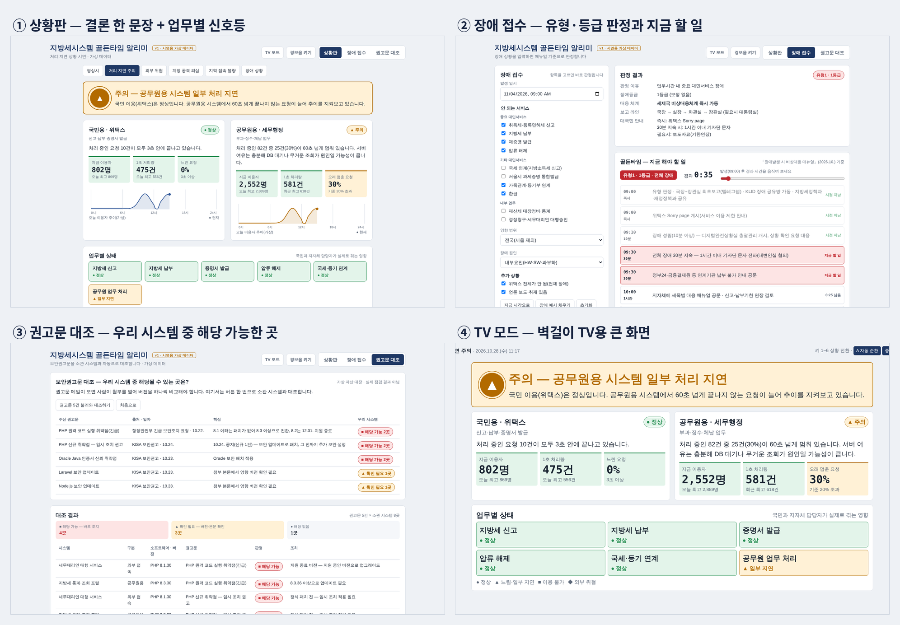

# 지방세시스템 골든타임 알리미

> **시스템 장애가 나도, 흔들리지 않게** — 장애·작업·해킹, 3대 위험이 닥쳤을 때 매뉴얼대로 **먼저 알리고, 빠짐없이, 같은 목소리로** 대응하도록 돕는 웹 도구입니다.
> AI 리더스 아카데미 · AI 프로젝트 제작 워크숍(AI Build Camp, 2026.10.27.~28.) 개인 프로젝트 · 임규진

- **바로 써 보기(배포 주소)**: https://mogaha3-ctrl.github.io/local-tax/
- **한 파일 버전(인터넷 없이 실행)**: [`dist/golden-time-alarm.html`](dist/golden-time-alarm.html) 내려받아 더블클릭



## 왜 만들었나

2026년 7월 1일, 지방세시스템이 12시간 멈췄습니다. 많은 분이 밤늦게까지 애썼지만 구조적인 어려움이 있었습니다.

1. **감시 화면은 전문가만 읽습니다** — 그래프 20여 개, TPS·X-View 같은 약어
2. **매뉴얼은 사람이 기억해야 합니다** — 기준 시각 7개(즉시·10분·30분·2시간·4시간·18시·12시간), 고쳐 써야 할 문서 10종
3. **위험은 장애만이 아닙니다** — 10월에는 PHP 치명적 취약점(해킹 비상), 금융권 연쇄 계정 공격, 보안권고문 5건이 잇따랐습니다

알리미는 「지방세정보시스템 장애발생 시 비상대응 매뉴얼」(2026.10.)을 **화면이 대신 실행**합니다.

## 주요 기능

| 화면 | 하는 일 |
|---|---|
| **상황판** | 전문가용 감시 화면을 누구나 읽게 바꾼 화면. 결론 한 문장, 국민용·공무원용 시스템 카드, 업무별 신호등(●▲■◆ 모양 병행) |
| ├ 6가지 상황 | 평상시 / 처리 지연 주의 / 외부 위협(PHP 해킹 비상) / 계정 공격 의심 / 지역 접속 불량 / 장애 상황 |
| ├ 외부 위협 | 사전 점검 6항목과 진행률, 업체 조치 요청·KLID 점검 요청·선제 중단 공지·상황 보고 문서 |
| ├ 계정 공격 의심 | 위성 시스템(외부에 열린 서비스) 점검판, 유출 시 72시간 통지·신고 기한, 사칭 문자 주의 안내 |
| ├ 지역 접속 불량 | 지자체별 접수 현황, **원인 가르기 3문항**(중앙·지자체 네트워크·권역 통신망·단말), 점검 요청·공유방 안내·보고 |
| └ 골든타임 패널 | 장애 시 매뉴얼 기준 "지금 할 일"과 남은 시간, 보고문 초안 |
| **장애 접수** | 발생 일시·안 되는 서비스를 고르면 유형(1·2·3)·장애등급·대응 체계·보고 라인 즉시 판정, 타임라인과 문서 4종 자동 작성 |
| └ 기한 계산 | 지방세기본법 §24 기한 특례(복구 다음 날, 주말·공휴일·근로자의 날이면 다음 날) 자동 계산 |
| **권고문 대조** | 보안권고문(PHP·Java·Laravel·Node.js)을 소관 시스템 자산 대장과 대조 → 해당 가능·확인 필요·해당 없음 표시, KLID 확인 요청문 자동 작성 |
| **재난문자형 경보** | 위급(화면 깜빡임+사이렌) / 긴급(경고음) / 안전안내(띠 알림) 3단계. 오른쪽 위 '경보음 켜기' |
| **TV 모드** | 사무실 벽걸이 TV용 큰 화면. 키 1~6 상황 전환, A 자동 순환, Esc 종료 |

모든 수치와 자산 대장은 **시연용 가상 데이터**입니다. 판정 결과와 문서는 **초안**이며 담당자가 검토 후 사용합니다.

## 써 보는 순서(1분)

1. **상황판** → '장애 상황' 클릭 → 화면이 붉게 깜빡이는 위급 경보 확인
2. **장애 접수** → '장애 예시 채우기' → 유형1·1등급 판정, 지금 할 일, 보고문 '복사'
3. **권고문 대조** → '권고문 5건 불러와 대조하기'
4. 오른쪽 위 **TV 모드** → 키보드 A(자동 순환)

## 기술 스택

- **순수 HTML·CSS·JavaScript** — 프레임워크·빌드 도구·외부 라이브러리 없음. 더블클릭으로도 실행, 공무원 PC·내부망에 그대로 설치 가능
- **판정 엔진 분리** — `js/engine.js`(순수 함수: 유형·등급·타임라인·기한·원인 분리·버전 대조)와 `data/*.js`(규칙표·문서 틀)
- **Web Audio API·Notification API** — 별도 음원 파일 없이 사이렌·경고음 생성
- **Node.js 서버(선택)** — 공공데이터포털 한국천문연구원 특일정보(공휴일) API 중계, 인증키는 서버 `.env`에만 보관
- **자동 검사** — `node tools/test.js` 판정 규칙 37개 사례
- **배포** — GitHub Pages(정적), 한 파일 버전(`dist/`)

## 실행 방법

**가장 쉬운 방법** — `index.html`을 더블클릭(공휴일은 임시 데이터 사용).

**공휴일 API까지 쓰는 방법**
```bash
cp .env.example .env        # Windows: copy .env.example .env
# .env 파일 안:  HOLIDAY_API_KEY=공공데이터포털에서_받은_인증키
node server.js              # Node.js 18 이상, 설치할 패키지 없음
# 브라우저에서 http://localhost:3000
```
화면 맨 아래 '공휴일:' 표시가 **한국천문연구원 특일정보 API**로 바뀌면 연결 성공입니다.

**검사·묶기**
```bash
node tools/test.js          # 판정 규칙 자동 검사
node tools/build-single.js  # dist/에 한 파일짜리 버전 생성
```

## 폴더 구조

```
index.html          화면 뼈대(상황판·장애 접수·권고문 대조)
css/style.css       디자인(라이트·다크, TV 모드)
js/engine.js        판정 계산 — 화면과 분리된 순수 함수
js/app.js           화면 동작·경보·TV 모드
data/rules.js       ★ 판정 규칙표 — 매뉴얼 기준값(서비스 분류, 시간, 보고 라인, 타임라인, 원인 분리 기준)
data/templates.js   ★ 문서 틀 — 보고문·공지·기자단 문자·위협·접속 불량·권고문 대응 문서
data/scenarios.js   상황판 시연 시나리오 6종(가상 데이터)
data/advisories.js  보안권고문 요약과 가상 자산 대장
data/holidays.js    공휴일 임시 데이터
server.js           로컬 서버 + 공휴일 API 중계
tools/              검사·묶기 도구
docs/screens/       화면 캡처
```

## 다른 시스템에도 쓰려면(범용 키트)

코드를 고치지 않고 **`data/rules.js`와 `data/templates.js`만** 바꾸면 됩니다.
1. `system` — 시스템 이름, 주소, 소관 부서
2. `services` — 서비스 목록과 분류(critical·public·internal)
3. `types`, `timeline` — 소관 매뉴얼의 대응 체계와 기준 시간
4. `templates.js` — 소관 부서 보고 양식

## AI 활용 방식

- 기획부터 코드·문서·발표자료까지 생성형 AI(Claude)와 대화하며 제작했습니다.
- 매뉴얼(hwpx)을 AI가 읽고 판정 규칙표로 옮긴 뒤, 담당자가 검토해 `data/rules.js`에 반영했습니다.
- 실제 감시 화면·보안 공문·KISA 안내문·현장 채팅을 AI가 분석해 시나리오와 문서 틀에 반영했습니다(내부 정보는 제외하고 가상 데이터로 재구성).
- 다음 단계(v3): 상황을 문장으로 입력하면 AI가 입력 항목을 채우는 에이전트 기능 — 내부망 승인 AI 환경을 전제로 합니다.

## 보안 원칙

- 공개 링크·전시물에는 **가상 데이터만** 사용합니다. 실제 장애 정보, 납세자 정보, 내부망 주소, 연락처는 넣지 않습니다.
- 인증키는 `.env`에만 두며 `.gitignore`로 업로드를 막습니다.
- 내부 모니터링 화면이나 문서를 외부 AI에 올리지 않는 것을 원칙으로 합니다.

## 확인이 필요한 값(`TODO 확인`)

- '업무시간' 정의(매뉴얼에 없음 → 평일 09~18시 준용)
- 사이버침해 시 내부 협조 절차(외부 신고처 KISA 118·보호나라, 유출은 개인정보보호위원회 — KISA 안내로 확인)
- Java 등 권고문 영향 버전 원문 대조(PHP는 KISA 안내와 일치 확인)
- 지역 접속 불량 격상 기준(동시 신고 5곳, 제안값)

## 로드맵

| 시기 | 내용 |
|---|---|
| 10월 | v1 — 상황판·판정·골든타임·외부 위협·계정 공격·지역 접속 불량·권고문 대조·경보·TV 모드 |
| 11월 1~2주 | v2 — 기한연장 자동 검토(납기 캘린더), 작업(패치)일정 사전경보, 보도자료·지자체 공문 |
| 11월 3주 | 과 내부 모의훈련으로 효과 측정(최초보고 소요 시간, 빠뜨린 조치 수) |
| 11월 4주~ | v3 — AI 에이전트, 모니터링 도구 데이터 연동, 범용 키트 정리 |
| 12월 | 온라인 작품전시회·성과공유회 |
